  

  
  
  
  

## Hi, I'm Arslan 👋

I'm a third-year **Computer Science** student at **Hangzhou Normal University** who likes building complete systems, from sensor firmware all the way to the screen people use.

- 🥫 **Latest:** [VYRA Energy](https://github.com/arslanagayev/vyra-energy), a scroll-driven 3D product website: procedural cans built from code with three.js, GSAP ScrollTrigger, 163 tests ([live demo](https://arslanagayev.github.io/vyra-energy/))
- 🎬 **Video series:** I explain how things actually work (passwords, websites, card payments, programming languages) in short videos rendered by my own [explainer engine](https://github.com/arslanagayev/explainer-engine)
- 🏭 **Building now:** an industrial IoT system: ESP32 sensor nodes in C++ → MQTT → a Python edge gateway → a live React dashboard with OEE and alarms
- 🎯 **Interests:** embedded systems, backend services (.NET, Python) and interactive web interfaces
- 💼 **Open to** software engineering internships for 2027
- 📱 I share how my projects are built on Instagram: [@arslanagayev.dev](https://www.instagram.com/arslanagayev.dev/)

## Featured projects

| Project | What it does | Built with |
|---|---|---|
| **[VYRA Energy](https://github.com/arslanagayev/vyra-energy)** [Live demo ↗](https://arslanagayev.github.io/vyra-energy/) | Scroll-driven 3D product site for a fictional energy drink. Five cans rise, spin and line up as you scroll; each can is generated from 17 points of code and its label is painted on a canvas, so there are no 3D model files. 163 tests, deployed by GitHub Actions. | TypeScript · Three.js · GSAP · Lenis · Vite |
| **[Nebula Auth](https://github.com/arslanagayev/nebula-auth)** [Live demo ↗](https://arslanagayev.github.io/nebula-auth/) | 3D sign-in and sign-up UI: a frosted-glass card over a 30,000-star WebGL galaxy that reacts to typing, password strength and login results. Accessible, with 240 tests and CI/CD to GitHub Pages. | TypeScript · Three.js · GLSL · Vite · Vitest |
| **[Explainer Engine](https://github.com/arslanagayev/explainer-engine)** | Turns a script and a voice-over into a 9:16 explainer video: word-synced captions, SVG scenes as pure functions of time, frame capture through the Chrome DevTools Protocol and an ffmpeg mix. Powers my "How it actually works" and "How languages actually work" series. | JavaScript · SVG · Node.js · Python · ffmpeg |
| **UI micro-interactions** | Six animated components, each in its own repo with a live demo: [OTP verify](https://github.com/arslanagayev/otp-verify-animation) · [Delete file](https://github.com/arslanagayev/delete-file-animation) · [Send file](https://github.com/arslanagayev/send-file-animation) · [Deploy button](https://github.com/arslanagayev/deploy-button-animation) · [Download button](https://github.com/arslanagayev/download-button-animation) · [Payment receipt](https://github.com/arslanagayev/payment-receipt-animation) | HTML · CSS · JavaScript (Web Animations API) · Figma |
| **[Lexify](https://github.com/arslanagayev/lexify)** | AI-powered English vocabulary platform: words enriched with real news examples, translations and etymology, SM-2 spaced repetition, quizzes and a Telegram assistant. | React · FastAPI · SQLite · DeepSeek API · Telegram |

<b>Earlier projects</b>

| Project | What it does | Built with |
|---|---|---|
| **[Password Manager](https://github.com/arslanagayev/password-manager-desktop)** | Desktop password vault with a dark theme and local storage. | C# · WPF (.NET 8) · SQLite |
| **[Task Manager API](https://github.com/arslanagayev/task-manager-api)** | My first ASP.NET Core REST API: create and list tasks, documented with Swagger. | C# · ASP.NET Core · Swagger |

## Tech stack

  
   
  

## How I work

- **Tested by default.** My recent projects ship with automated tests and CI on every push.
- **Readable history.** Small, conventional commits that explain *why*.
- **AI-assisted, human-owned.** I use AI tools to move faster and make sure I understand and can explain every line I ship.

Thanks for stopping by ✨

